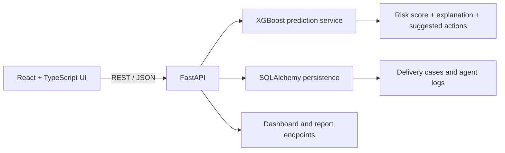

# Venlix AI — Delivery Risk Intelligence for Gated Communities

Venlix is a full-stack prototype for surfacing delivery-failure risk in gated-community operations. It combines an XGBoost-backed prediction service with a FastAPI backend and a React/TypeScript dashboard.

The current public code focuses on delivery-risk prediction, case records, explanations, operational dashboards, and privacy-aware handling of customer fields.

## Key capabilities

- **Delivery risk prediction** using a serialized XGBoost model and shared feature/label-encoding assets.
- **Risk explanations and recommended actions** returned alongside prediction results.
- **Delivery-case workflow** for creating and retrieving cases.
- **Dashboard and reporting APIs** for delivery summaries, analytics, drivers, societies, and live-delivery views.
- **Simulation endpoints** for creating and resetting demo delivery activity.
- **Privacy controls** that mask customer fields by default, record access events, and support predictive-contact consent and retention expiry.
- **React dashboard** built with TypeScript and Vite.

> **Prototype boundary:** the public backend demonstrates prediction and simulated delivery operations. A verified, end-to-end live phone-call or SMS provider integration is not evident in the current API code. Treat calling and messaging as simulated or planned until an actual integration is configured and tested.

## Architecture



## Technology stack

- **Frontend:** React, TypeScript, Vite, React Router, Recharts, Axios
- **Backend:** Python, FastAPI, SQLAlchemy, Pydantic, Uvicorn
- **Machine learning:** XGBoost, pandas, NumPy, scikit-learn, joblib
- **Data and model artifacts:** CSV datasets, serialized model, feature columns, label encoders

## Repository layout

```text
Venlix/
├── backend/
│   ├── app.py
│   ├── config.py
│   ├── database.py
│   ├── crud.py
│   ├── models.py
│   ├── schemas.py
│   ├── routers/
│   └── services/
├── frontend/
│   ├── src/
│   ├── package.json
│   └── .env.example
├── data/
│   └── datasets and evaluation artifacts
├── models/
│   ├── venlix_model.pkl
│   ├── feature_columns.pkl
│   ├── label_encoders.pkl
│   └── model_metadata.json
└── notebooks/
```

## Run locally

### 1. Backend

From the repository root:

```bash
cd backend
python -m venv .venv
```

Activate the environment, then install dependencies:

```bash
# Windows PowerShell
.venv\Scripts\Activate.ps1

# macOS / Linux
source .venv/bin/activate

pip install -r requirements.txt
uvicorn app:app --reload --port 8000
```

Open the FastAPI docs at [http://127.0.0.1:8000/docs](http://127.0.0.1:8000/docs).

### 2. Frontend

In a second terminal, from the repository root:

```bash
cd frontend
npm ci
```

Copy `.env.example` to `.env` and set `VITE_API_URL=http://localhost:8000`. Configure Clerk, EmailJS, and Supabase values only if you are testing those frontend integrations. Do not put server-side secrets in this file.

Start Vite:

```bash
npm run dev
```

## API surface

| Method | Endpoint | Purpose |
|---|---|---|
| GET | `/health` | Backend health check |
| POST | `/predict` | Generate a delivery-risk prediction |
| POST | `/delivery_cases` | Create a delivery case |
| GET | `/delivery_cases/{case_id}` | Retrieve a case |
| PATCH | `/delivery_cases/{case_id}/privacy` | Update consent/privacy settings |
| GET | `/delivery_cases/{case_id}/explanation` | Return risk explanation for a case |
| GET | `/dashboard` | Dashboard summary |
| GET | `/reports/` | Delivery reporting summary |
| GET | `/deliveries/` | Delivery history |
| POST | `/simulation/start` | Start demo simulation |
| POST | `/simulation/pause` | Pause demo simulation |
| POST | `/simulation/reset` | Reset demo simulation |

Use FastAPI Swagger UI for request schemas and the complete route list.

## Model evaluation

The prediction service loads a serialized model and shared feature/label assets from `models/`. Evaluation files and feature-importance artifacts are stored under `data/`.

Before making model-quality claims, report the held-out dataset, class balance, precision, recall, F1, ROC-AUC, and threshold-selection method. This README does not claim a performance figure without a reproducible evaluation result.

## Security and privacy notes

- Never commit `.env` files or private provider credentials.
- Any browser-exposed `VITE_*` variable is public to users; never put secret keys in it.
- Replace hardcoded demo customer records in API responses with synthetic fixtures and avoid returning real customer PII.
- Verify authorization and retention behavior before describing the system as production-ready.

## License

No license file is currently documented. Add an explicit license if you intend to accept external reuse or contributions.
